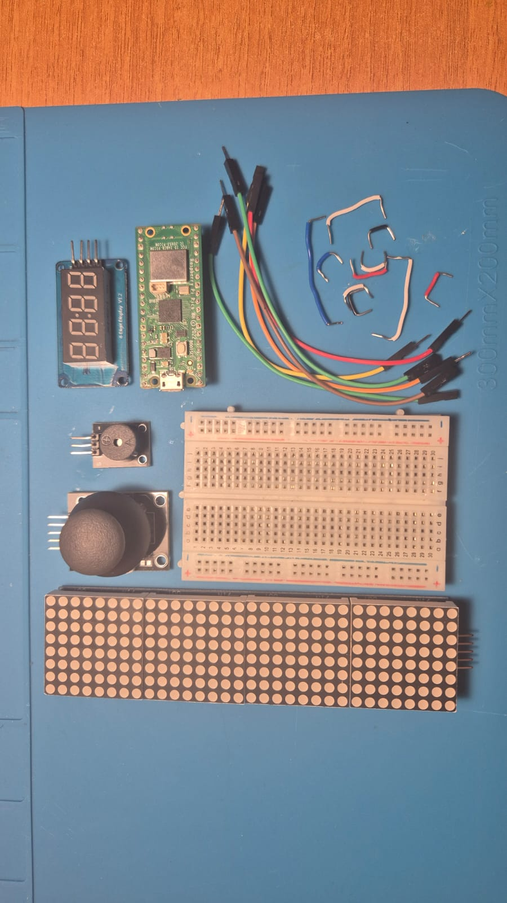
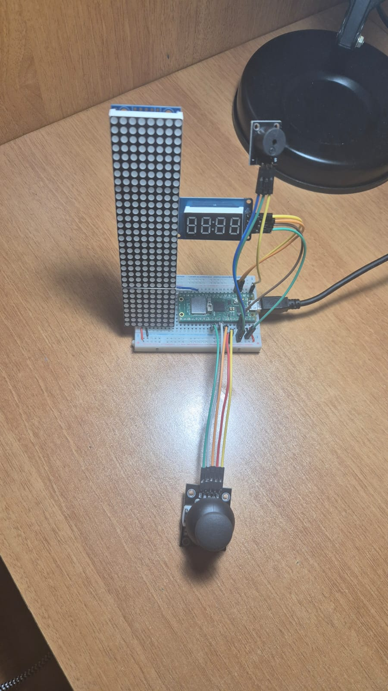

# 🕹️ MicroPython Pico Tetris (8x32 LED Matrix & Joystick)

A feature-complete, arcade-style **Tetris game** built for the **Raspberry Pi Pico** using MicroPython. 

This embedded project features dynamic piece rotation, full-line detection with blink clearing animations, variable gravity fall speeds, a dedicated 4-digit score display, custom audio sound effects, and a top-row piece preview window rendered on a 4-in-1 MAX7219 LED Matrix display.

---

## 🕹️ Gameplay Demo & Hardware Setup

*(Upload your build images or demo video to GitHub and place them here!)*

| Hardware Assembly | 8x32 Matrix Grid & Scoreboard |
| :---: | :---: |
|  |  |

---

## ✨ Key Features

* **Classic 7 Tetromino Shapes**: Includes all original piece shapes (`I`, `O`, `T`, `L`, `J`, `S`, `Z`) with 90° rotation mechanics.
* **Top Piece Preview Window**: The top 4 rows of the matrix dynamically display and center your incoming `Next Piece` behind a divider line.
* **Smart Arcade Controls**: 
  * **Analog Joystick**: Smooth Left/Right shift and Downward soft-drop speed acceleration.
  * **Joystick Click Button**: Smooth 90° matrix shape rotation.
* **Line Clearing & Score System**:
  * **Visual Animations**: Completed lines flash before shifting remaining rows down.
  * **Multi-line Scoring**: Exponential score table matching arcade scoring (`100` / `300` / `600` / `1200` pts).
  * **TM1637 4-Digit Display**: Real-time score readout update.
* **Dynamic Speed Curve**: Fall gravity speeds up automatically as lines are cleared.
* **Buzzer Audio FX**: Custom sound effects for game boot, line clears, and game-over conditions.

---

## 🧰 Hardware & Schematic Pinout

### Wiring Connections

| Component | Pin / Module | Pico GPIO Connection | Notes |
| :--- | :--- | :--- | :--- |
| **Microcontroller** | Raspberry Pi Pico | — | Running MicroPython |
| **MAX7219 Matrix** | SPI SCK | **GP14** | Clock Signal |
| **MAX7219 Matrix** | SPI MOSI | **GP11** | Data Output |
| **MAX7219 Matrix** | CS / Load | **GP13** | Chip Select |
| **TM1637 Scoreboard** | CLK | **GP2** | Clock Line |
| **TM1637 Scoreboard** | DIO | **GP3** | Data Input/Output |
| **KY-023 Joystick** | VRX (X-Axis) | **GP27 (ADC1)** | Left / Right Movement |
| **KY-023 Joystick** | VRY (Y-Axis) | **GP26 (ADC0)** | Soft Drop / Fast Fall |
| **KY-023 Joystick** | SW (Button) | **GP22** | Rotate Piece (Active-Low) |
| **Active Buzzer** | I/O Pin | **GP0** | Audio Effects Output |

> **Fritzing Schematic**: You can find the full circuit diagram file (`Schematic Games.fzz`) inside the repository!

---

## 📂 Repository Structure

```text
.
├── main.py              # Core Tetris game loop and hardware controller (TETRIS.py)
├── max7219.py           # MAX7219 8x8 LED matrix driver library
├── tm1637.py            # TM1637 7-segment display driver library
├── Schematic Games.fzz  # Fritzing schematic file
└── README.md            # Project documentation
⚡ Quick Start & Installation
Flash MicroPython: Flash your Raspberry Pi Pico with the latest MicroPython firmware.

Upload Drivers: Upload max7219.py and tm1637.py to your Pico using Thonny IDE.

Save Game File: Save TETRIS.py onto the Pico as main.py so it automatically executes when powered up via USB or battery.

Play!: Move the joystick left/right to position pieces, pull down to drop faster, and press the joystick button to rotate!

📄 License
This project is open-source under the MIT License.
